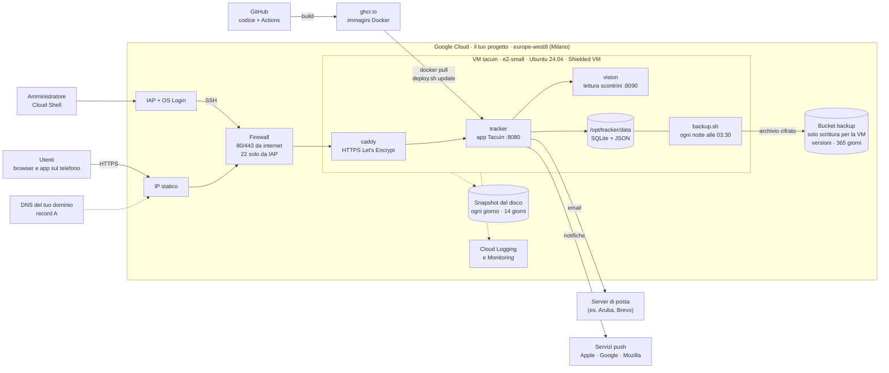

# Architettura su Google Cloud

Tacuìn gira su **una sola VM a Milano** (`europe-west8-a`). Dentro la VM tre container Docker fanno tutto il lavoro: Caddy per l'HTTPS, l'app Tacuìn e il servizio che legge gli scontrini. Da internet sono aperte solo le porte web 80 e 443; la VM si amministra solo con l'account Google, passando da IAP. Tutta l'infrastruttura è descritta in Terraform (`main.tf`) e si crea con `deploy.sh`.

## I pezzi

| Componente | Cosa fa | Dove è definito |
| --- | --- | --- |
| VM `tacuin` | e2-small (2 vCPU condivise, 2 GB), Ubuntu 24.04, disco 20 GB, Shielded VM (secure boot, vTPM) | `main.tf` → `google_compute_instance.vm` |
| IP statico | Indirizzo fisso a cui punta il record A del tuo dominio | `google_compute_address.ip` |
| Rete e firewall | VPC dedicata; 80 e 443 aperte a tutti; 22 aperta solo agli indirizzi di IAP (`35.235.240.0/20`) | `google_compute_firewall.web`, `ssh_iap` |
| IAP + OS Login | SSH solo con l'account Google autorizzato, nessuna chiave SSH da custodire | `admin_iap`, `admin_oslogin`, metadati della VM |
| Caddy | HTTPS con certificato Let's Encrypt automatico, HSTS, compressione; per gli indirizzi aggiunti da *Impostazioni → Server* crea il certificato al primo accesso, dopo aver chiesto a Tacuìn se il dominio è autorizzato | `deploy/Caddyfile`, `docker-compose.yml` |
| tracker | L'app Tacuìn (Python), raggiungibile solo da Caddy; file system in sola lettura tranne `/data` | `docker-compose.yml` |
| vision | Legge le foto degli scontrini (OpenCV + OCR); raggiungibile solo dall'app | `docker-compose.yml`, `vision/` |
| Dati | Database SQLite (utenti, sessioni, inviti) e un file JSON per utente, in `/opt/tracker/data` | volume `./data:/data` |
| Backup | Ogni notte alle 03:30 un archivio cifrato va nel bucket; la VM può solo crearne di nuovi, non leggerli né cancellarli | `deploy/backup.sh`, `google_storage_bucket.backup` |
| Snapshot | Copia dell'intero disco ogni giorno alle 02:00 (UTC), tenuta 14 giorni | `google_compute_resource_policy.snapshots` |
| Log e metriche | La VM scrive log e metriche su Cloud Logging e Monitoring | `vm_logs` |
| Avviso di spesa | Email al 50%, 90% e 100% del budget mensile (se è impostato l'account di fatturazione) | `google_billing_budget.budget` |

## Come arriva una richiesta

1. Il browser chiede il tuo dominio: il DNS risponde con l'IP statico della VM.
2. Il firewall lascia passare solo 80 e 443; Caddy risponde in HTTPS e passa la richiesta all'app.
3. L'app controlla la sessione, legge o scrive i dati dell'utente e risponde.
4. Per una foto di scontrino l'app chiama il servizio `vision`; email e notifiche escono verso il tuo server di posta e i servizi push dei browser.

## Come arriva una nuova versione

1. Ogni push su GitHub fa partire le Actions: costruiscono le immagini Docker e le pubblicano su `ghcr.io`; un secondo controllo verifica Terraform e gli script.
2. Da Cloud Shell, `./deploy.sh update` fa un backup, scarica le nuove immagini sulla VM e riavvia i container.
3. `./deploy.sh up` serve solo quando cambia l'infrastruttura (`main.tf`): Terraform mostra il piano e chiede conferma.

## Dove sta la sicurezza

- **Da internet** si vedono solo 80 e 443; la porta 22 non è esposta.
- **Nei container**: file system in sola lettura, nessuna capability, nessuna escalation di privilegi, utente non root. I container non possono interrogare il server dei metadati di Google, quindi non possono rubare il token della VM.
- **Identità della VM**: un service account con i permessi minimi, cioè scrivere log e metriche e creare file nel bucket dei backup.
- **Backup**: cifrati prima di uscire dalla VM, con versioni e cancellazione recuperabile per 7 giorni. Anche se la VM venisse compromessa, i backup già salvati non si possono toccare.
- **Segreti**: il file `.env` (password, chiavi, SMTP) esiste solo sulla VM e in `deploy/gcp/app.env` nella tua Cloud Shell; non è mai su GitHub. La password della casella email salvata da *Impostazioni → Server* è cifrata con una chiave che resta in `data/`.

## Costi indicativi

Circa 14 $/mese per la VM accesa, 3,65 $ per l'IP statico, pochi centesimi per disco, snapshot e backup. Con `./deploy.sh stop` la VM si spegne e restano solo disco e IP.
